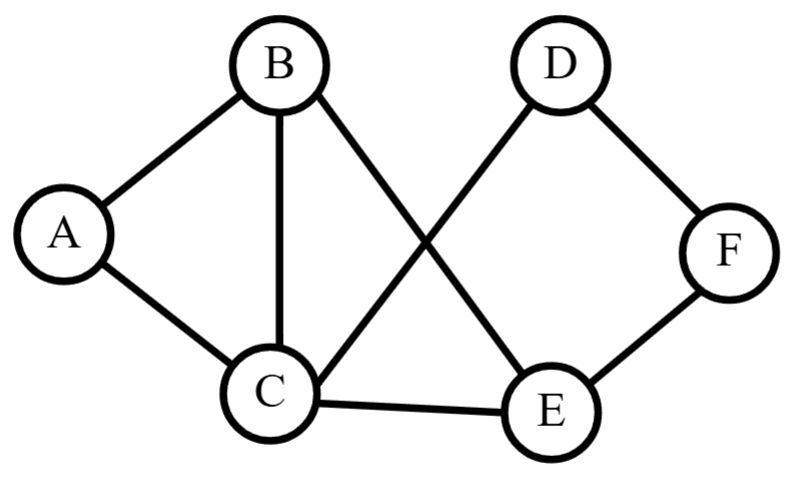
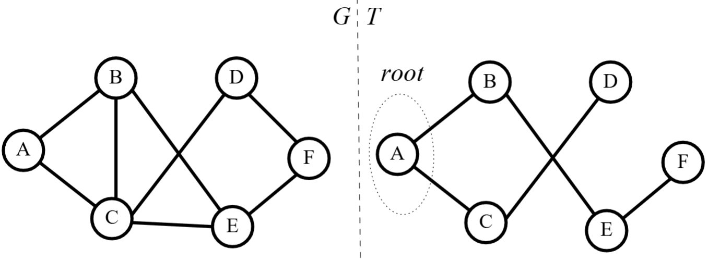

# Lecture 16: Breadth-First Search


### Warmup

First, recall BFS from last class:


````{prf:definition} Breadth-First Search (graph)
- Input: A graph $G=(V,E)$ and a starting vertex "$root$"
- Body: Build a tree $T$
     1. Initialize a graph $T$ on vertices $V$ with no edges
     2. Label $root$ explored
     3. Let $Q=(root)$ (an ordered list).
     4. While $Q$ is not empty:
        - 4a. Remove first element $u\in Q$.
        - 4b. For each edge $\{u,v\}\in E$:
            - If $v$ is not explored,
                - label it explored
                - add $\{u,v\}$ to $T$ 
                - add $v$ to end of $Q$
- Output: A tree $T$ from $G$
````

````{prf:question}

Do BFS on the following graph using $A$ as the root. Why is the output a tree? Why a spanning tree?



````

````{dropdown} Answer
What you should end up with is the following. Today we'll discuss why this algorithm produces a spanning tree when a connected graph is inputted!


````

### Generating Spanning Tree

````{prf:theorem}

If a connected graph is inputted into B.F.S. (graph), the output will be a spanning tree.

````

````{prf:proof}
Let $G=(V,E)$ be a connected graph inputted into BFS (graph) with $T$ being its output. We want to show that:

1. $T$ is spanning (has all the vertices of $G$)
2. $T$ is connected (has a path between every pair of distinct vertices)
3. $T$ has no cycles (has no paths that start and end at the same vertex)

__Spanning__: Well, in our algorithm above, step 1 initializes $T$ with all the vertices of $G$. So, $T$ is spanning!

__Connected__: We want to show that every vertex has a path to $root$ in $T$ (and so every pair of distinct vertices have a path between them). We will proceed by induction. 

- <u>Base case</u>: Since $G$ is connected, there is some vertex who shares an edge with $root$. At the first iteration, any vertex sharing an edge with $root$ will be labelled explored and the edge between them will be added to $T$. So, all of these vertices have a path to $root$ consisting of a single edge.

- <u>Inductive hypothesis</u>: Assume there is a path between all vertices that have been explored up to iteration $k$ and the vertex $root$. 

- <u>Induct</u>: Consider the vertices newly explored at iteration $k+1$. Let $x_{k+1}$ be one of these vertices. It must be the case that, up to this point, $x_{k+1}$ was previously unexplored and we are considering some edge $\{u,x_{k+1}\}$ for an explored vertex $u\in Q$. Step 4b dictates that we will add $\{u,x_{k+1}\}$ to $T$. Since $u$ must have been explored <it>before</it> this iteration, the induction hypothesis says there is a path $P$ between $u$ and $root$. So, $P$ together with the edge $\{u,x_{k+1}\}$ will form a path between $x_{k+1}$ and $root$.

Thus, there is always a path between explored vertices and $root$ in $T$. So, we can form paths between any pair of vertices in $T$ such that $T$ is connected.

__No Cycles__: Note that Step 4 of BFS will only add an edge $\{u,v\}$ to $T$ when $u$ is an explored vertex and $v$ is an unexplored vertex. If it were the case that adding this edge created a cycle, there must have already been an edge containing $v$. This means that $v$ must have already been labelled explored. This contradicts Step 4 only adding edges between an explored vertex and an unexplored one.

Therefore, the output $T$ is spanning, connected, and has no cycles. Thus, $T$ is a spanning tree.
````
